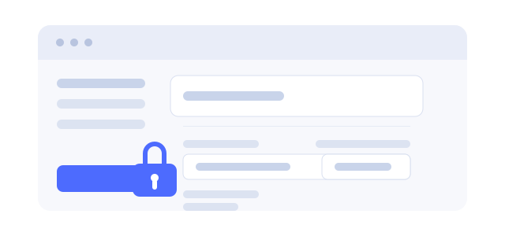

# dsh-default-model-lock

English | [中文](README.zh.md)

[](https://www.npmjs.com/package/dsh-default-model-lock)
[](https://www.npmjs.com/package/dsh-default-model-lock)
[](https://github.com/Panmax/dsh-default-model-lock/actions/workflows/publish.yml)
[](LICENSE)

**Keep the shared default model fixed in DeepSeek Harness.**<br />
Switching to Opus or another expensive model in one chat changes only that chat. New sessions, scheduled automations, and other Agent entry points keep starting from the profile's configured default model.

<p align="center">
  
</p>

## Features

- **Write-only lock** — Wraps `ctx.agentDefaultModel.saveSelection()` as a no-op. Session-local selection through `agent.model.select()` and the chat model picker still works normally.
- **One source of truth** — `currentSelection()` keeps reading the official `agent-default-model` configuration. The plugin adds no second model route and makes no model requests.
- **Visual settings page** — **Settings → Default model lock** shows the current pinned selection and offers provider, model, and reasoning-effort selectors backed by the live model catalog.
- **Explicit off switch** — Disable the `default-model-lock` row in **Plugins** to restore the official behavior: a model-picker selection becomes the default for new sessions again.
- **Bounded failure handling** — Catalog errors and partial provider failures are reported with a retry action; unsupported or stale saved values stay visible instead of being silently substituted.

## Installation

### CLI

```sh
# Install from npm
dsh plugin --profile web add dsh-default-model-lock

# Enable or disable at any time (hot-reloads with HMR)
dsh plugin --profile web enable dsh-default-model-lock
dsh plugin --profile web disable dsh-default-model-lock

# Remove the bundle
dsh plugin --profile web remove dsh-default-model-lock
```

### Web UI

1. Open **Plugins** in the left sidebar.
2. Click **Add plugin**, enter `dsh-default-model-lock`, and install.
3. Open **Settings → Default model lock** to choose the pinned model.

## Configuration

The page writes the official `agent-default-model` entry, so the profile patch remains the source of truth:

```yaml
- id: agent-default-model
  config:
    provider: magpie
    model: auto/deepseek-v4.1-flash
    reasoningEffort: max
```

| Field | Meaning |
| --- | --- |
| `provider` | Exact registered provider route kept as the shared default. |
| `model` | Provider-owned model id kept as the shared default. |
| `reasoningEffort` | Optional effort id; empty uses the adapter's default effort. |

Existing sessions keep their own recorded model. Only sessions created afterwards read the locked default.

## Architecture

- **Host (`index.js`, `src/host.js`)** — Replaces `saveSelection()` on the live `agentDefaultModel` service instance via Cordis's `Symbol.for('cordis.original')`, and restores the original method when the plugin unloads.
- **Client (`src/client-core.js`, `src/client-entry.js`, generated `client.js`)** — Registers `settings.section` and `settings.section.icon`; the page reads `agent-default-model` through `ctx.configForms` and the catalog through `ctx.remote.session.modelCatalog()`.
- **No core edits** — The plugin is a bundle: `dsh.bundle.patch` inserts the `default-model-lock` row and `dsh.client` serves the browser half.

## Development

```sh
npm run build        # Generate root client.js from src/client-core.js + src/client-entry.js
npm test             # Host lock, client registration, build sync, manifest, locale, icon checks
npm pack --dry-run   # Inspect the published file list
```

## Limits

- While the lock is active, every `saveSelection()` call is ignored, including the DeepSeek-account `initializeDefaultModel()` fallback. Disable the lock before first-run account setup if no other provider key is configured.
- The wrapper targets the live service instance. A DSH upgrade that changes `@deepseek-ai/dsh-agent-default-model` internals may require a compatibility check.

## License

[MIT](LICENSE)
