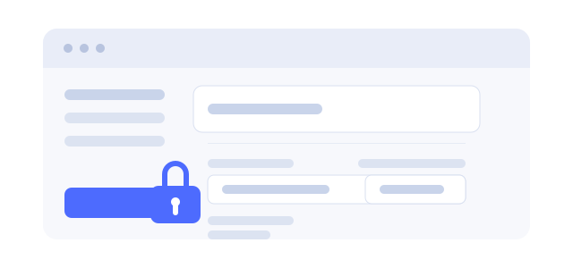

# dsh-default-model-lock

[English](README.md) | 中文

[](https://www.npmjs.com/package/dsh-default-model-lock)
[](https://www.npmjs.com/package/dsh-default-model-lock)
[](https://github.com/Panmax/dsh-default-model-lock/actions/workflows/publish.yml)
[](LICENSE)

**固定 DeepSeek Harness 的共享默认模型。**<br />
在一个会话里切到 Opus 或其他高价模型，只影响该会话；新会话、自动化任务和其他 Agent 入口仍会使用 profile 中配置好的默认模型。

<p align="center">
  
</p>

## 核心特性

- **只拦写入** —— 把 `ctx.agentDefaultModel.saveSelection()` 包成空操作；`agent.model.select()` 和聊天里的模型选择器仍然正常工作。
- **单一配置源** —— `currentSelection()` 继续读取官方 `agent-default-model` 配置。插件不增加第二套模型路由，也不发起任何模型请求。
- **可视化设置页** —— **设置 → 默认模型锁定** 展示当前锁定值，并提供基于实时模型目录的供应商、模型和推理档位下拉框。
- **明确的关闭方式** —— 在 **插件** 页关闭 `default-model-lock` 行，即恢复官方行为：模型选择器的选择会重新成为新会话默认值。
- **有界失败处理** —— 模型目录加载失败或部分供应商失败时会显示错误与重试按钮；已保存但不可用的值会保留展示，不静默替换。

## 安装

### 命令行（CLI）

```sh
# 从 npm 安装到 web Profile
dsh plugin --profile web add dsh-default-model-lock

# 随时启用或禁用（HMR 实时热生效）
dsh plugin --profile web enable dsh-default-model-lock
dsh plugin --profile web disable dsh-default-model-lock

# 卸载插件
dsh plugin --profile web remove dsh-default-model-lock
```

### Web 图形界面

1. 打开左侧边栏的 **插件（Plugins）** 页面。
2. 点击 **添加插件（Add plugin）**，输入 `dsh-default-model-lock` 完成安装。
3. 打开 **设置 → 默认模型锁定** 选择要固定的模型。

## 配置

设置页写入官方 `agent-default-model` 条目，因此 profile patch 始终是唯一事实来源：

```yaml
- id: agent-default-model
  config:
    provider: magpie
    model: auto/deepseek-v4.1-flash
    reasoningEffort: max
```

| 字段 | 含义 |
| --- | --- |
| `provider` | 保持为共享默认模型注册的 provider 路由。 |
| `model` | provider 拥有的模型 id。 |
| `reasoningEffort` | 可选推理档位；留空使用适配器默认档。 |

已有会话保留各自记录的模型；只有之后新建的会话会读取锁定后的默认值。

## 架构

- **Host（`index.js`、`src/host.js`）** —— 通过 Cordis 的 `Symbol.for('cordis.original')` 替换在线 `agentDefaultModel` 服务实例上的 `saveSelection()`，插件卸载时恢复原方法。
- **Client（`src/client-core.js`、`src/client-entry.js`、生成的 `client.js`）** —— 注册 `settings.section` 和 `settings.section.icon`；页面通过 `ctx.configForms` 读取 `agent-default-model`，通过 `ctx.remote.session.modelCatalog()` 读取模型目录。
- **不改核心代码** —— 插件是标准 bundle：`dsh.bundle.patch` 插入 `default-model-lock` 行，`dsh.client` 提供浏览器端。

## 开发

```sh
npm run build        # 从 src/client-core.js + src/client-entry.js 生成根目录 client.js
npm test             # Host 锁定、Client 注册、构建同步、manifest、locale、icon 检查
npm pack --dry-run   # 查看发布文件列表
```

## 限制

- 锁定开启时，所有 `saveSelection()` 调用都会被忽略，包括 DeepSeek 账号的 `initializeDefaultModel()` 兜底。首次登录 DeepSeek 账号且没有其他 provider key 时，请先关闭锁定。
- 插件包装的是在线服务实例；DSH 升级如果改变 `@deepseek-ai/dsh-agent-default-model` 内部实现，需要重新验证兼容性。

## 许可证

[MIT](LICENSE)
